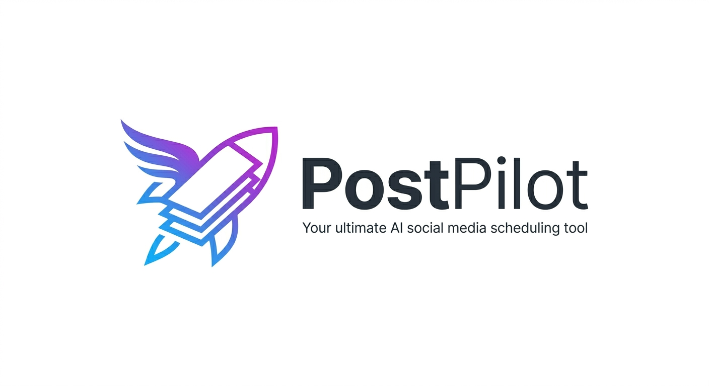

<div align="center">
  

  <h1>🚀 PostPilot</h1>
  <p><em>The Ultimate Open-Source Social Media Scheduling &amp; Engagement Platform</em></p>
  <p>Built by <a href="https://github.com/PelleNybe"><strong>Pelle</strong></a> at <a href="https://coraxcolab.com"><strong>Corax CoLAB</strong></a></p>

  <p>
    <a href="https://github.com/PelleNybe/Post-Pilot/stargazers"></a>
    <a href="https://github.com/PelleNybe/Post-Pilot/network/members"></a>
    <a href="https://github.com/PelleNybe/Post-Pilot/issues"></a>
    <a href="https://github.com/PelleNybe/Post-Pilot/blob/main/LICENSE"></a>
    <a href="https://buymeacoffee.com/pellenybe"></a>
  </p>
</div>

> **PostPilot** is an open-source, multi-tenant social media scheduling, analytics, and automation platform built with Next.js, NestJS, Prisma, Temporal, Redis, and AI tooling. Schedule across 28+ social and chat channels from a single workspace.

---

## ✨ Key Features

- **🧠 AI-Powered Composer & Assistants**
  - **AI Viral Hook Generator & Tone Transformer:** Generate attention-grabbing opening hooks and rewrite drafts across tones (Professional, Casual, Funny, Inspirational) directly from the post editor.
  - **Smart Hashtags, Auto-Translation & Alt Text:** Inject hashtags, translate drafts across supported languages, and generate descriptive image alt text.
  - **Readability, Sentiment, UTM Optimizer & Threadify:** Real-time feedback while writing, one-click UTM parameters, and automatic multi-post thread splitting.
- **🏢 Multi-Tenancy & Enterprise Collaboration**
  - **Fine-Grained RBAC:** Role-based policies protecting post scheduling, integrations, media, billing, webhooks, and organization settings.
  - **Content Moderation & Bulk Actions:** Approval workflows (`Needs Approval`), bulk state actions from the calendar grid, and undo/redo post revision handling.
  - **Integration Health Checks & Token Refresh:** Proactive token expiration checks (`POST /integrations/health`) and automatic OAuth refresh persistence.
  - **Analytics & Telemetry:** Organization-wide overview metrics (`GET /analytics/overview`), per-channel analytics, and CSV export.
- **⚙️ Durable Orchestration & Developer Interfaces**
  - **Temporal Workflows (`apps/orchestrator`):** Durable scheduling, delayed thread comments, retries, auto-posting, digest/streak emails, and plug automations.
  - **Developer Tools:** Official [CLI](./apps/cli/README.md), [Node.js SDK](./apps/sdk/README.md), MCP server support, and [Chrome Browser Extension](./apps/extension) for cookie-backed integrations.

---

## 🏗️ Monorepo Architecture

| Path | Description | Default Port / Target |
|------|-------------|-----------------------|
| [`apps/backend`](./apps/backend) | NestJS REST & public v1 API | `http://localhost:3000` |
| [`apps/frontend`](./apps/frontend) | Next.js App Router web UI | `http://localhost:4200` |
| [`apps/orchestrator`](./apps/orchestrator) | Temporal worker for workflows & activities | Temporal `7233` |
| [`apps/commands`](./apps/commands) | NestJS CLI admin tasks (token refresh, agent runs) | CLI task runner |
| [`apps/cli`](./apps/cli/README.md) | `postpilot` command-line client for users & AI agents | `POSTPILOT_API_URL` (`http://localhost:3000`) |
| [`apps/sdk`](./apps/sdk/README.md) | `@postpilot/node` TypeScript/Node.js SDK | `http://localhost:3000` |
| [`apps/extension`](./apps/extension) | Manifest V3 browser extension (Vite + `@crxjs/vite-plugin`) | `dist/` / `extension.zip` |
| [`libraries/nestjs-libraries`](./libraries/nestjs-libraries/README.md) | Shared NestJS modules, Prisma services/repositories, social & AI providers | Internal workspace library |
| [`libraries/helpers`](./libraries/helpers/README.md) | Shared auth, JWT/AES encryption, SSRF validation & utility helpers | Internal workspace library |
| [`libraries/react-shared-libraries`](./libraries/react-shared-libraries/README.md) | Shared React form controls, SWR/upload helpers, and 15 i18n locales | Internal workspace library |

---

## 🚀 Getting Started

### Prerequisites

- **Node.js:** `>=22.12.0 <23.0.0` (Node 22 LTS)
- **Package Manager:** `pnpm@10.6.1` (`corepack enable`)
- **Infrastructure:** Docker & Docker Compose (for PostgreSQL, Redis, and Temporal)

### Installation & Local Development

```bash
# 1. Clone the repository
git clone https://github.com/PelleNybe/Post-Pilot.git
cd Post-Pilot

# 2. Install workspace dependencies
pnpm install

# 3. Configure environment variables
cp .env.example .env
# Edit .env with your database, Redis, Temporal, JWT_SECRET, Stripe, and social OAuth credentials

# 4. Start PostgreSQL, Redis, and Temporal locally
pnpm run dev:docker

# 5. Generate Prisma client and push schema
pnpm run prisma-generate
pnpm run prisma-db-push

# 6. Run backend, frontend, orchestrator, and extension in watch mode
pnpm run dev
```

Once running:
- Frontend UI: `http://localhost:4200`
- Backend API: `http://localhost:3000`

### Useful Scripts

| Command | Description |
|---------|-------------|
| `pnpm run dev` | Starts frontend, backend, orchestrator, and extension in parallel dev mode |
| `pnpm run dev-backend` | Starts only backend and frontend |
| `pnpm run build` | Builds frontend, backend, and orchestrator |
| `pnpm --filter postpilot run build` | Builds the CLI (`apps/cli`) |
| `pnpm --filter @postpilot/node run build` | Builds the Node.js SDK (`apps/sdk`) |
| `pnpm run build:extension` | Builds the Chrome extension bundle and zip archive |
| `pnpm test` | Runs Jest test suites with coverage across workspaces |
| `pnpm run lint` | Runs ESLint across the repository |

---

## 👨‍💻 Creator & Maintainer

<table align="center" width="100%">
  <tr>
    <td width="50%" align="center">
      <h3><strong><a href="https://github.com/PelleNybe">Pelle Nyberg</a></strong></h3>
      <p><em>Lead Developer</em></p>
      <a href="https://github.com/PelleNybe">
        
      </a>
      <br /><br />
      <a href="https://github.com/PelleNybe"></a>
      <a href="https://www.linkedin.com/in/pellenyberg/"></a>
      <a href="https://buymeacoffee.com/pellenybe"></a>
    </td>
    <td width="50%" align="center">
      <h3><strong><a href="https://coraxcolab.com">Corax CoLAB</a></strong></h3>
      <p><em>Organization</em></p>
      <a href="https://coraxcolab.com">
        
      </a>
      <br /><br />
      <a href="https://coraxcolab.com"></a>
    </td>
  </tr>
</table>

---

## 💖 Support & Sponsor

If you find **PostPilot** useful, consider supporting its ongoing open-source development:

<a href="https://buymeacoffee.com/pellenybe">
  
</a>

---

## 🤝 Contributing, Releases & License

- Please read [CONTRIBUTING.md](./CONTRIBUTING.md) before opening a pull request.
- Please review [SECURITY.md](./SECURITY.md) for private vulnerability disclosure instructions.
- See [CHANGELOG.md](./CHANGELOG.md) for release notes and version history.
- Licensed under the [GNU Affero General Public License v3.0 (AGPL-3.0)](./LICENSE).
